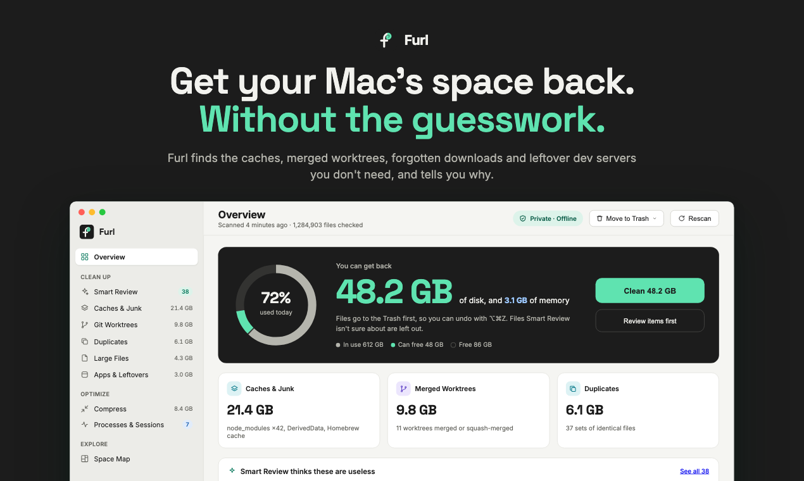
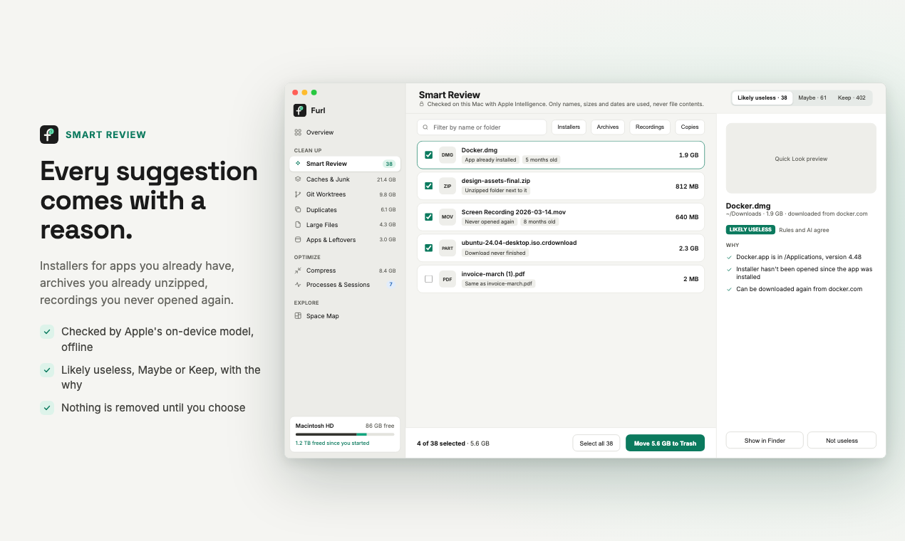
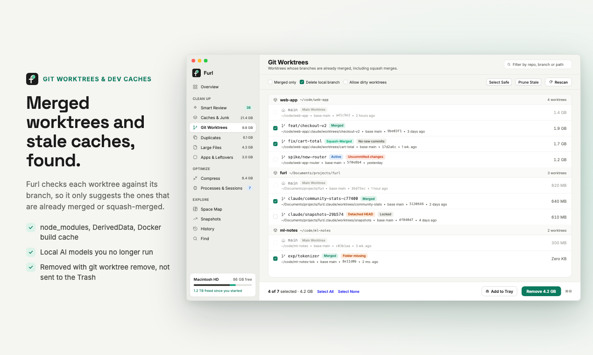
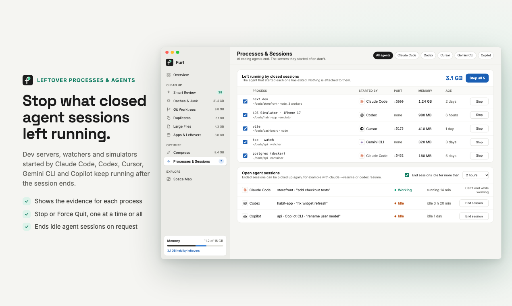
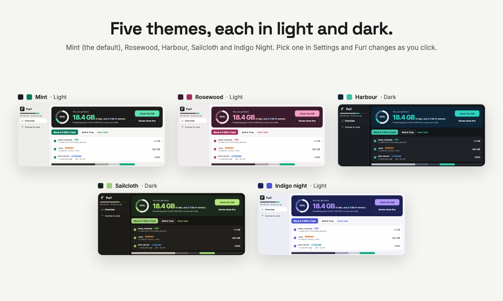

# Furl

A native SwiftUI macOS desktop utility for reclaiming disk space, cleaning merged Git worktrees, removing developer/system junk, and uninstalling apps along with orphaned `~/Library` data.

Free and open source. **[Download Furl.dmg](https://github.com/punitm0/furl/releases/latest/download/Furl.dmg)** · [getfurl.app](https://getfurl.app) · [First-launch help](https://getfurl.app/install/)

<picture>
  <source media="(prefers-color-scheme: dark)" srcset="docs/screenshots/hero-dark.png">
  
</picture>

## Features

- **Overview**: Live macOS volume usage, reclaimable space breakdown, Trash size & one-click Empty Trash, configurable project scan folders, and **Move to Trash** (default) vs. **Delete Permanently** safety toggle.
- **Git Worktrees**: Scans project folders for multi-worktree Git repos, detects **Merged** (`git branch --merged`) and **Squash-Merged** (`git cherry` plus a synthetic squash-commit comparison, all local) worktrees, flags dirty/locked/prunable worktrees, optionally deletes the local branch, and runs `git worktree prune`.
- **Caches & Junk**: Finds stale `node_modules`, `.next`, `.turbo`, `.venv`, `target`, Xcode `DerivedData`/`Archives`/`DeviceSupport`, Homebrew/npm/pnpm/pip/uv/SwiftPM caches, app logs/crash reports, old `.dmg`/`.pkg`/`.zip` installers in `~/Downloads`, `.DS_Store` files, Docker build cache and unused iOS Simulators, and local AI models (Ollama, Hugging Face, LM Studio) for you to review.
- **Apps & Leftovers**:
  - **Installed Apps**: Inspects `/Applications` and `~/Applications`, maps associated folders/plists across `~/Library/{Application Support, Caches, Preferences, Containers, Group Containers, Saved Application State, Logs, WebKit, HTTPStorages}`, quits running apps if needed, and lets you uninstall the app only or the app + selected data.
  - **Uninstalled App Data**: Detects orphaned `~/Library` data left behind by previously uninstalled apps (excluding Apple/system/CLI allowlisted items) so you can clear leftovers individually or all at once.
- **Space Map**: Scans your home folder, the whole disk, an external volume or any folder, then lets you drill down folder by folder with bars sized to scale, a breadcrumb trail, and Remove from the right-click menu.
- **Duplicates**: Finds identical files by content (size → partial hash → full SHA-256) in Desktop/Documents/Downloads/media folders. It's hard-link and APFS-clone aware: copies that already share storage are flagged and not counted as reclaimable. Auto-select keeps the oldest, newest or shortest-path copy, and Furl never removes every copy in a group.
- **Smart Review (on-device AI)**: Looks through your home folder for files that are probably useless (installers for apps you already have, archives you already unzipped, unfinished downloads, old logs, screenshots and screen recordings never opened again, `(1)`/`copy` duplicates) and labels each one *Likely Useless*, *Maybe* or *Keep* with a reason you can check. Apple's on-device model (Foundation Models, macOS 26+ with Apple Intelligence) double-checks the top 240 suggestions. It sees only names, folders, sizes, dates and download source, never file contents, and nothing leaves the Mac. The model can't call a file useless without supporting evidence from the rules, and photos and documents top out at *Maybe*. Without Apple Intelligence it falls back to the rules. Right-click → "Not Useless" hides a file for good.
- **Large Files**: Scans `~` (excluding `~/Library`) for files above a configurable threshold (50 MB – 1 GB+) grouped by disk images, archives, media, and models/data.
- **Compress**: Lossless compression of folders you rarely open, using APFS transparent compression and per-format recompressors (plus optional Homebrew tools you install with one click). Every output is verified before the original is replaced, and originals go to the Trash so a run can be undone.
  - **Shrink** (opt-in, lossy): re-encodes photos, videos and PDF images at a lower quality, with a preview of the savings first. It skips libraries apps manage themselves, such as the Photos library, and cloud-synced folders.
  - **Format suggestions**: files that would be much smaller in another format (for example HEIC). Nothing converts until you pick it.
- **Processes & Sessions**: Finds dev servers, watchers, simulators and containers that AI coding agents (Claude Code, Codex, Cursor, Gemini CLI, Copilot) started and left running after the session ended, with the memory each one holds. Stop them one at a time or all at once, and end idle agent sessions. Databases, tunnels and terminal multiplexers are never stopped automatically.
- **Snapshots**: "Why is my disk full?" Furl keeps compact snapshots of your home folder's sizes (daily for 30 days, weekly for 6 months) and shows what grew and when.
- **History**: Every cleanup, Auto-Sweep run and compression, with Undo for anything that went to the Trash or was replaced, even after a relaunch.
- **Find & Inspector** (⌘F): one search across every scan result. Any row opens the Inspector with the details, and you can ignore a path so it never shows up again.
- **Cleanup Tray**: Collect items from different sections and clean them together in one step.
- **Menu bar & Auto-Sweep**: Free space in the menu bar, low-disk alerts, "Clean safe items", and optional scheduled rules (caches and stale `node_modules`, a Downloads tidy-up, compressing cold folders, leftover dev servers, expiring old Furl items from the Trash). Auto-Sweep is off by default. Its rules move things to the Trash, except the Trash-expiry rule, which permanently removes old items Furl itself put there.
- **Themes**: Mint, Rosewood, Harbour, Sailcloth and Indigo Night, each in light and dark.

## Screenshots

<picture>
  <source media="(prefers-color-scheme: dark)" srcset="docs/screenshots/smart-review-dark.png">
  
</picture>

<picture>
  <source media="(prefers-color-scheme: dark)" srcset="docs/screenshots/worktrees-dark.png">
  
</picture>

<picture>
  <source media="(prefers-color-scheme: dark)" srcset="docs/screenshots/processes-dark.png">
  
</picture>

<picture>
  <source media="(prefers-color-scheme: dark)" srcset="docs/screenshots/themes-dark.png">
  
</picture>

## Accurate sizes

Reclaimable sizes use APFS *private size* (`ATTR_CMNEXT_PRIVATESIZE`), the bytes a file doesn't share with clones, and skip hard-linked files. pnpm, Finder's Duplicate and `cp -c` create clones that look full-size but free nothing when deleted. The Overview total also avoids double counting: a `node_modules` inside a merged worktree only counts once. The Space Map shows size on disk the way Finder does.

## Usability

- **Automatic scanning**: everything is scanned when the app opens (toggle in Settings), and worktrees/junk rescan when scan folders change.
- **Settings window (⌘,)**: deletion mode, scan folders (Also scan / Never scan), Full Disk Access shortcut. Rules sit on their screens: "Dependencies count as unused after" on Caches & Junk, "Bigger than" on Large Files. Right-click a row and choose "Don’t scan here…" to add its folder to Never scan. All settings persist.
- **Keyboard**: ⌘R scan everything, ⇧⌘R rescan current section, ⌘1–⌘9 switch sections, ⌘O add scan folder, ⌘⌫ clean the current selection.
- Search, sorting and category chips in every list; right-click any row to Reveal in Finder, Open or Copy Path; drop folders onto the scan-folder list.
- **Undo**: every Move-to-Trash cleanup can be undone from the banner or with ⌥⌘Z. Deletions show live progress.
- Safety: protected system/home folders can never be deleted, Empty Trash asks first, dirty worktrees are only removed with “Allow dirty worktrees”, and brand-new branches with no commits are never auto-selected.

## Requirements

- **Run:** macOS 14 Sonoma or later. Smart Review's on-device model needs macOS 26 with Apple Intelligence; without it Smart Review uses its rules only.
- **Build:** Xcode 16 or later (Swift 6.0 toolchain); Xcode 26 or later to include Smart Review's on-device model. There are no third-party Swift dependencies.

## Build & Run

```bash
./scripts/build_app.sh
open build/Furl.app
```

Or run the unbundled binary directly (notifications are off when it isn't inside an app bundle):

```bash
swift run Furl
```

To make a DMG, run `./scripts/make_dmg.sh` after `build_app.sh`. It asks for permission to control Finder so it can lay out the window. Builds are ad-hoc signed, not notarized, so macOS shows the "Open Anyway" step on first launch.

`make_dmg.sh` also writes `build/Furl.dmg.sha256` and `build/Furl.dmg.sig`, which Furl's self-update needs. See [docs/releasing.md](docs/releasing.md) for the signing key and the release checklist.

## Repository layout

- `Sources/Furl`: the app.
- `Sources/ScanBench`: a command-line benchmark for the scan engine (`swift run -c release ScanBench new`; no argument prints the command list); see `docs/scan-benchmarks.md`.
- `stats-worker/`: the Cloudflare Worker behind the public community counter.
- `website/`: the getfurl.app site (Astro).

## Contributing and security

See [CONTRIBUTING.md](CONTRIBUTING.md) and the [Code of Conduct](CODE_OF_CONDUCT.md). Please report security problems privately as described in [SECURITY.md](SECURITY.md), not in a public issue.

## License

Furl is released under the [MIT License](LICENSE). Copyright (c) 2026 Punit Makwana.

Claude, OpenAI Codex, Cursor, Gemini and GitHub Copilot are trademarks of their respective owners. Furl shows their logos only to identify which tool started a process and is not affiliated with or endorsed by them. Logo shapes come from [Simple Icons](https://simpleicons.org) (CC0).
